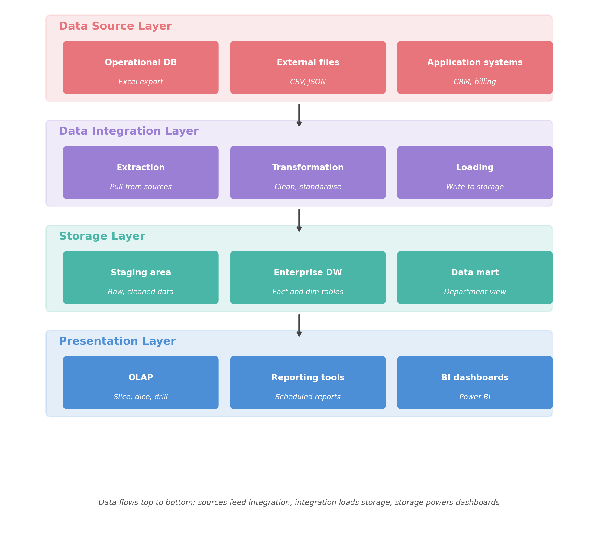
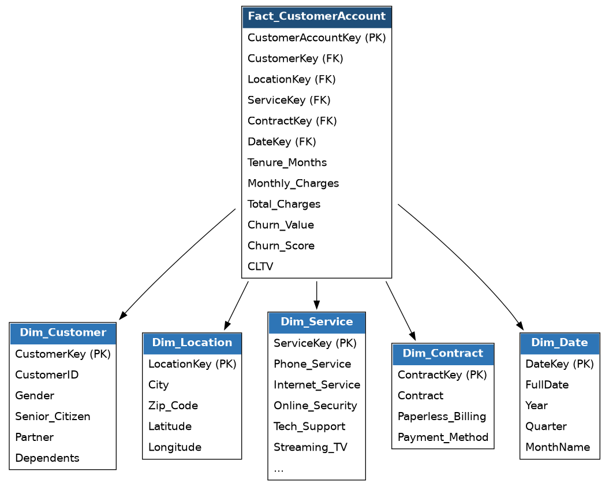
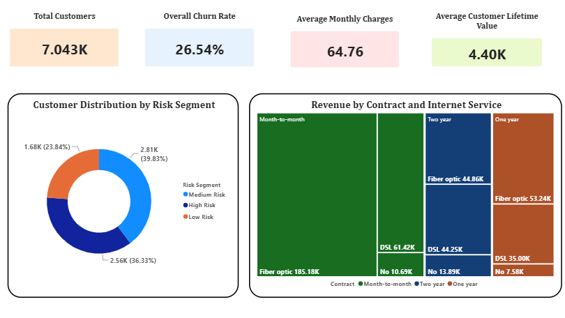
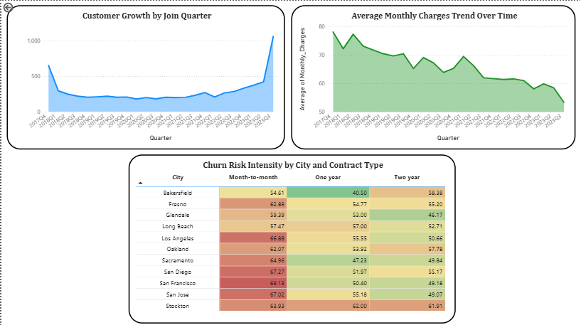
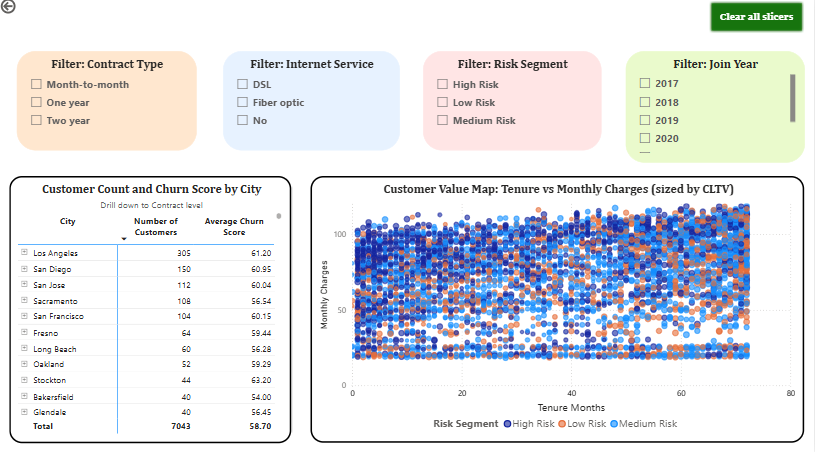

# Telecom Churn Data Warehouse & Business Intelligence

An end-to-end academic data warehousing and business intelligence project that integrates telecom customer data, builds a validated star schema, and presents churn and retention insights through an interactive Power BI dashboard.

## Project Overview

- **Module:** IT3101 - Data Warehousing and Business Intelligence
- **Institution:** Sri Lanka Institute of Information Technology
- **Project type:** Academic team project
- **Domain:** Telecommunications and customer retention
- **Dataset size:** 7,043 customer accounts

The project combines data integration, ETL engineering, dimensional modelling, SQL validation, and interactive business intelligence. Data from CSV and JSON sources is transformed into a warehouse with five dimensions and one central fact table.

## Solution Architecture



### Data pipeline

1. Extract customer billing, location, and service-subscription data.
2. Clean missing values and standardise fields.
3. Create derived customer-spend and tenure attributes.
4. Build customer, location, service, contract, and date dimensions.
5. Load a customer-account fact table with surrogate keys.
6. Validate foreign keys, row counts, and churn-rate consistency.
7. Analyse the warehouse through a Power BI semantic model and dashboard.

## Data Model



The model contains:

- `Dim_Customer`
- `Dim_Location`
- `Dim_Service`
- `Dim_Contract`
- `Dim_Date`
- `Fact_CustomerAccount`

## Dashboard

### Executive Summary



### Trend Analysis



### Interactive Analysis



## Selected Findings

- Overall churn rate: **26.54%** across 7,043 customer accounts.
- High-risk customers: **2,559 (36.33%)**.
- Medium-risk customers: **2,805 (39.83%)**.
- Low-risk customers: **1,679 (23.84%)**.
- The largest displayed revenue category was month-to-month fibre optic service.
- Warehouse validation found no orphan foreign keys and preserved source row counts.

## Technologies

- Python and pandas
- SQLite
- Microsoft SQL Server / T-SQL
- Power BI and DAX
- CSV, JSON, and Excel source integration
- Dimensional modelling and star-schema design

## Repository Structure

```text
telecom-churn-dwbi/
|-- README.md
|-- etl_pipeline.py
|-- generate_ssms_star_schema.py
|-- Telecom_Churn_Dashboard_StarSchema.pbix
|-- telecom_dw.db
|-- requirements.txt
|-- data-sources/
|-- sql/
|-- outputs/
`-- assets/
```

## Run the ETL Pipeline

Install the dependencies:

```bash
pip install -r requirements.txt
```

The supplied source files are organised in `data-sources/`. Run:

```bash
python etl_pipeline.py
```

The script creates the cleaned warehouse, validates row counts and foreign keys, and writes an ETL log.

## Team Project Notice

This repository presents work completed collaboratively for an academic module. It is shared as a portfolio record of the team's data-engineering and business-intelligence workflow.

